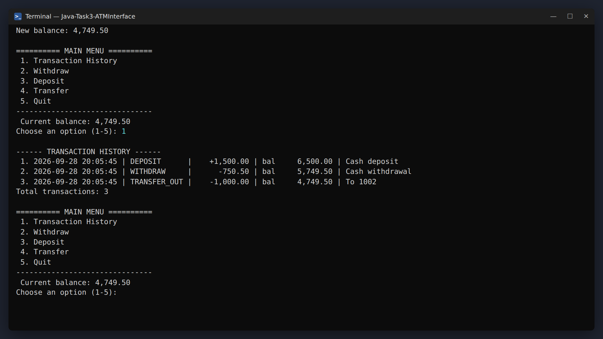
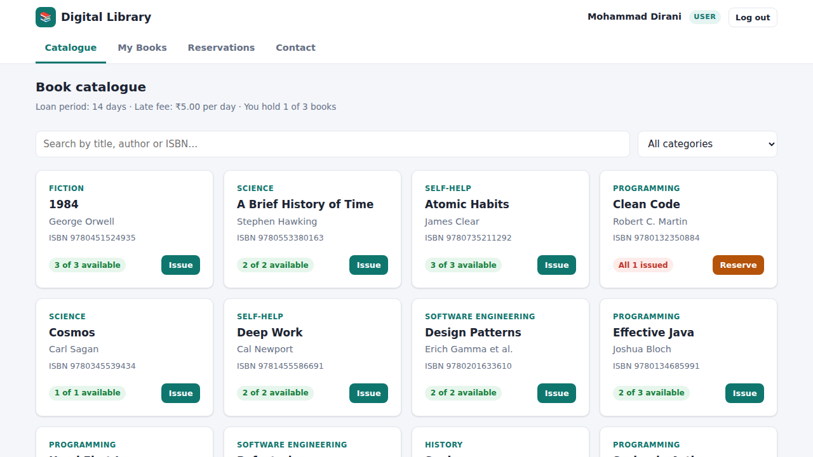
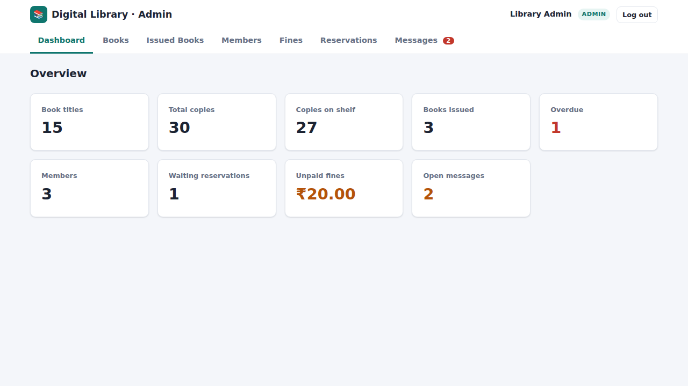

# OIBSIP: Oasis Infobyte Internship Projects

**Mohammad Dirani**, Java Development Intern at [Oasis Infobyte](https://oasisinfobyte.com) · #oasisinfobyte

This repository holds my task submissions for the **Java Development** track of the Oasis Infobyte Student Internship Program (OIBSIP). Each task has its own folder with source code, a README and screenshots.

## Tasks

| # | Project | Description | Tech |
|---|---|---|---|
| 3 | [**ATM Interface**](Java-Task3-ATMInterface) | Console ATM with PIN login (3-attempt lock), withdraw, deposit, transfer and transaction history | Java, OOP (5 classes), BigDecimal, SHA-256 |
| 5 | [**Digital Library Management System**](Java-Task5-DigitalLibrary) | Web app with Admin and Member roles: catalogue, issue and return, automatic overdue fines, reservation queue, contact form, admin dashboard | Spring Boot 3 REST API, Spring Security, JPA, H2, HTML/CSS/JS, JUnit + MockMvc |

## Previews

| ATM Interface | Digital Library: Member | Digital Library: Admin |
|---|---|---|
|  |  |  |

## Running the Projects

**ATM Interface** (Java 11+):
```bash
cd Java-Task3-ATMInterface
javac -d out src/atm/*.java
java -cp out atm.Main          # demo login: 1001 / 1234
```

**Digital Library** (Java 17+):
```bash
cd Java-Task5-DigitalLibrary
./mvnw spring-boot:run         # Windows: mvnw.cmd spring-boot:run
# open http://localhost:8080 (admin: admin@library.com / Admin@123)
```

Each project's README has the full feature list, design notes and demo accounts.

## Folder Naming

`OIBSIP/Java-Task<N>-<ProjectName>/`, following the internship submission guidelines.

## Connect

- GitHub: [@mhmddirany](https://github.com/mhmddirany)
